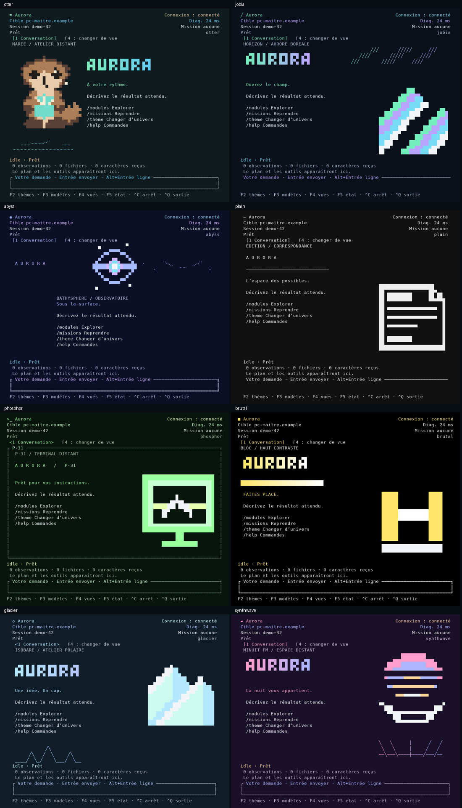

# Compositions du CLI — 29 octobre 2026

Les corrections d'interaction ont été fusionnées par PR #5 (`a89c91c`). Ce lot répond au défaut visuel restant : les huit thèmes utilisaient le même découpage. Ils ont désormais huit géométries distinctes en hauteur normale, une typographie et des ornements déclaratifs. En 60×24, ils convergent vers une composition compacte qui conserve les quatre actions. Le changement de thème garde le contexte distant et la zone de saisie stables.



[Avant/après Marée](before-after.png) · [Repli Python](python-themes.png) · [captures natives](captures/native) · [captures Python](captures/python)

Les PNG sont des rasterisations des cellules des vrais renderers, avec un état de démonstration. Ce ne sont pas des maquettes ni des captures du Mac. L'avant/après utilise l'ancienne capture historique à gauche ; l'outil de rasterisation actuel corrige aussi le dessin des demi-blocs et du braille, donc cette amélioration de l'image de preuve ne doit pas être attribuée au terminal lui-même.

## Vérifications exécutées

- Suite Python : **1377 réussis, 18 ignorés, 5 sous-tests**, 15,52 s sur cet hôte Linux. Les exclusions préexistantes concernent des modules optionnels ; elles ne prouvent pas leur fonctionnement.
- Rust : **20 tests réussis**, dont chaque thème à 60×24 et 60/80/120/200×32, Unicode et ASCII/NO_COLOR.
- **16 parcours Python réels** : huit thèmes × couleur ou ASCII/NO_COLOR, resize 80×32 → 60×24 → 120×32 → 200×32 ; quatre actions toujours visibles, pas de défilement horizontal.
- Ruff, `cargo fmt --check`, Clippy avec `-D warnings`, build Rust release, wheel et sdist réussis.
- **240 snapshots texte**, dont **96 accueils**, avec manifeste SHA-256. 72 PNG d'accueil conservés ; le script régénère tous les PNG et les états. Les textes et marqueurs fonctionnels sont vérifiés indépendamment de la couleur.
- PTY Linux : natif truecolor et repli Python NO_COLOR avec scénario étendu (deux soumissions explicites, thème en mission, Ctrl+C dans le sélecteur) ; natif ANSI, 256 couleurs et NO_COLOR avec scénario standard. Socket coupée, reprise SSE avec curseur 1, sans nouvelle création de la mission interrompue. Aucun modèle ni bridge de production sollicité.
- Premier écran observé : natif truecolor **110,115 ms**, Python NO_COLOR **117,466 ms** ; mémoire maximale observée des processus **50,629 / 49,074 Mio**. Aucun octet ni CPU discernable au repos sur 1,5 s, résolution CPU 10 ms. Mesures ponctuelles à caches chauds, pas des p95 ni des résultats Mac.

Commandes reproductibles depuis la racine du dépôt (dépendances de développement installées, `pyte`, `psutil` et Pillow nécessaires aux scripts) :

```sh
python -m pytest tests -q
python -m ruff check aurora_cli tests scripts
python -m build --no-isolation
cargo fmt --manifest-path native/Cargo.toml --check
cargo clippy --locked --all-targets --manifest-path native/Cargo.toml -- -D warnings
cargo test --locked --manifest-path native/Cargo.toml
cargo build --release --locked --manifest-path native/Cargo.toml
python scripts/render_snapshots.py --native native/target/release/aurora-native --output /tmp/aurora-snapshots
python scripts/validate_terminal.py --depth truecolor --extended --output /tmp/aurora-pty
python scripts/validate_terminal.py --renderer python --depth none --extended --output /tmp/aurora-pty
```

## Auto-critique et limites

La distinction entre thèmes porte maintenant sur la disposition, pas seulement sur les couleurs. La lecture des commandes a priorité sur le décor ; le mot-symbole se simplifie lorsqu'il manque de place. Le repli Python affiche les scènes statiques ; les transitions décoratives à cadence maximale de 60 Hz appartiennent au renderer natif. Cette cadence programmée ne prouve pas 60 images effectivement affichées sur le Mac.

La conversation, la saisie et le contexte distant gardent une structure commune pour préserver les gestes. Le langage visuel reste celui des cellules et du pixel art ; le qualificatif « waouh » est une appréciation à faire sur les rendus fournis, pas une propriété déduite de tests verts. Kitty/iTerm2/Sixel restent réservés à l'aperçu de thème et non au plein écran.

Le Mac physique, la connexion authentifiée de l'utilisateur et les générations des modèles ne sont pas validés. La copie CLI du PC est encore à `f893b6f`, propre ; le serveur reste à `4baddbd` avec des changements locaux. Aucune de ces copies n'a été modifiée. Le plan moteur demeure un document, sans implémentation.
