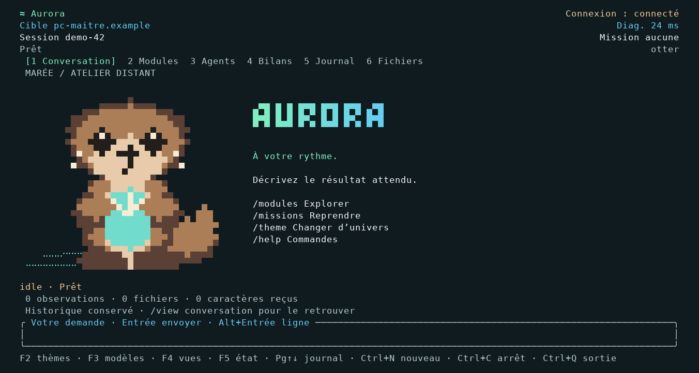

# Réparation après retour du Mac — 30 octobre

Le retour réel de l'utilisateur invalide l'affirmation implicite qu'une CI verte suffisait à valider son installation. Les deux défauts reproduits étaient absents des fixtures historiques : Cargo manquant suivi d'un export invalide, et `steps` entier dans un statut de mission. Sept tests ont échoué avant correction. Le format a été vérifié directement dans les sources du serveur ; aucune génération 3D n'a été lancée.

- **Lancement** : un chemin natif absent ne bloque plus auto. La version 1.5.1 cherche aussi le binaire installé et vérifié dans la venv ; une demande native explicite reste une erreur si aucun exécutable n'existe.
- **Installation** : binaires compilés/testés sur GitHub pour Mac ARM/Intel et Linux/Windows x64 ; téléchargement borné et contrôlé par SHA-256, version et protocole avant remplacement atomique. Aucun appel à Cargo sur le poste client, aucun téléchargement au démarrage. Une panne de distribution laisse Python disponible et affiche le motif.
- **Statut** : `steps` compte les étapes commencées, `plan` contient les textes. Listes nulles ou malformées ne font plus planter le consommateur et ne suppriment pas les détails déjà reçus. Un parcours `/3d` simulé vérifie aussi l'absence d'exception dans les callbacks de l'event loop.
- **Accueil** : thème et renderer sont indépendants. Le choix synthwave persisté reste respecté ; `jobia theme set otter` choisit la loutre. L'historique restauré peut montrer l'accueil, `/home` y revient, `/view conversation` retrouve les messages, sans suppression ni nouvelle soumission. Une alerte reste prioritaire.
- **Tests d'installation** : le profil shell est désormais simulé. Les lignes PATH vers des dossiers pytest laissées par les tests antérieurs sur le poste d'exécution ont été supprimées après sauvegarde privée ; aucun profil du Mac utilisateur n'a été accessible.

Validation locale du lot : **1406 Python réussis, 18 ignorés, 5 sous-tests**, 20 tests Rust, Ruff/fmt/clippy et build release/wheel/sdist. Deux vrais PTY Linux avec bridge simulé : natif truecolor et Python ASCII/NO_COLOR, statut réel, deux soumissions explicites, thème en mission, arrêt dans le sélecteur, coupure puis curseur 1. Zéro sortie au repos sur 1,5 s. Les JSON adjacents sont des mesures ponctuelles, pas des p95.

**256 captures** régénérées ; 112 accueils gardent les quatre commandes. Les huit accueils avec historique restauré en **120×30** sont conservés pour chaque renderer. PNG = cellules rasterisées, pas capture du Mac physique. Le manifeste référence les empreintes des textes générés par `scripts/render_snapshots.py`.

Le workflow de release attend la matrice de tests, publie les quatre binaires puis télécharge et vérifie chacun depuis une installation Python normale hors checkout. Les Mac et Linux exécutent ensuite le PTY étendu avec le binaire téléchargé. Le résultat effectif de publication et de ces vérifications est consultable dans GitHub Actions ; ne pas le déduire de la seule présence du workflow.

Limites : pas d'accès au Mac physique ni aux identifiants de connexion. Ces correctifs prouvent le traitement du protocole et le rendu, pas la qualité ou le succès d'une génération 3D du moteur. Aucun service, modèle, poids ou secret du PC maître n'est modifié. Le document maître présente un catalogue CLI antérieur aux commits publiés ; les sources concernées ont été revues directement.
