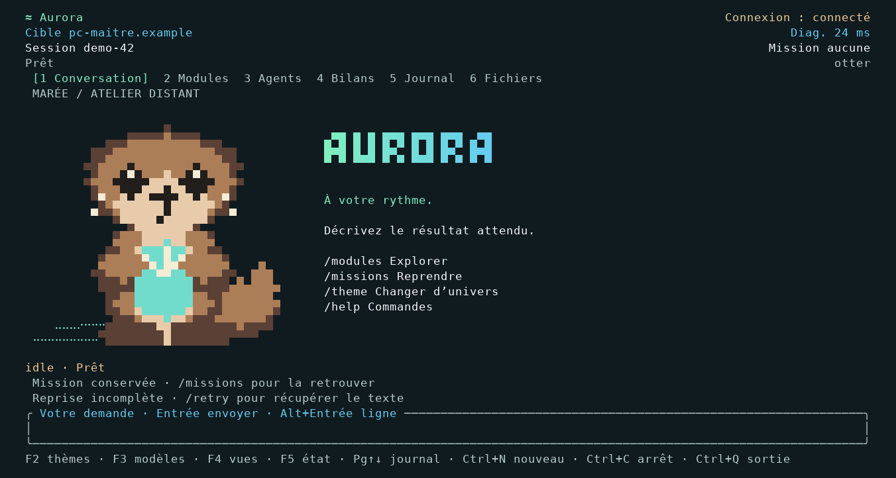

# Démarrage avec mission conservée

La capture Mac montrait otter chargé et une connexion établie, mais l'avis « Mission conservée » ouvrait la conversation à la place du dessin. Six variantes ont reproduit le défaut avant correction : avec/sans messages, mission seule ou accompagnée d'une demande incertaine/incomplète. Le test précédent ne restaurait que les messages.

Les avis de reprise restent maintenant visibles sous l'accueil, sans effacement ni requête de mission. Ils suivent l'état courant et disparaissent lorsqu'il est résolu. Les erreurs continuent d'ouvrir le diagnostic. Aucun changement du moteur ou des configurations réelles.

80 captures des deux renderers : huit thèmes × (60×24, 80×32, 120×30, 200×60, 60×24 ASCII/NO_COLOR). Chaque texte conserve /modules, /missions, /theme, /help, les deux avis et /retry. Empreintes dans snapshots.json ; 20 PNG conservés pour inspection. Les PNG sont des cellules rasterisées, pas des captures du Mac physique.

Les parcours PTY locaux natif truecolor et Python ASCII/NO_COLOR restaurent l'état via Conversation.open(), puis vérifient que les archives ne changent pas et qu'aucun POST n'est envoyé au démarrage. Ils testent ensuite deux soumissions explicites, reprise SSE 0→1, thème en mission, resize et arrêt dans un sélecteur. Les JSON adjacents sont des mesures ponctuelles, pas des p95 ni une validation du moteur 3D.

La validation GitHub ajoute le vrai ./install.sh et la résolution de jobia dans le PATH du terminal appelant. Après publication, les Mac ARM/Intel et Linux lancent jobia sans argument depuis la wheel installée et le binaire téléchargé ; ce résultat ne doit pas être supposé avant la fin du workflow de release. Windows conserve son contrôle de téléchargement/exécution.

Le PATH de recherche de Python du shim masquait aussi l'absence de ~/.local/bin dans le PATH appelant : test reproduit, puis corrigé. Les tests de profils utilisent des fichiers temporaires ; aucun profil Mac réel n'est accessible.
